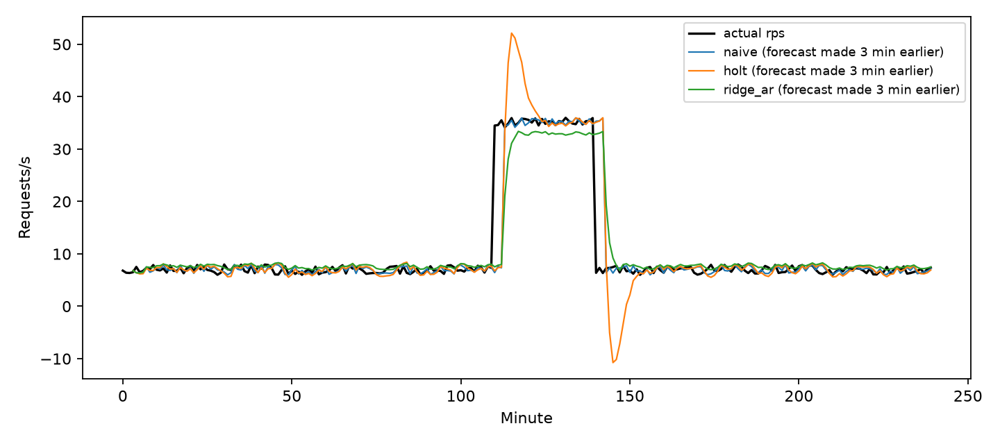
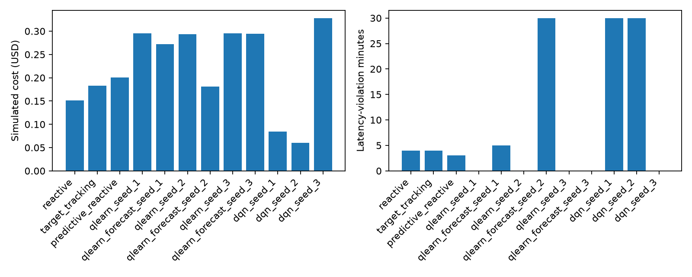
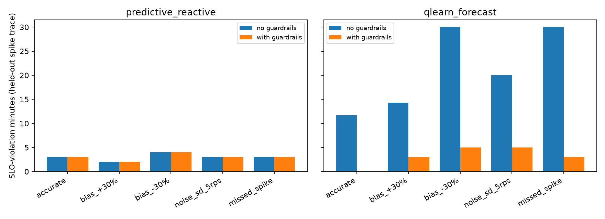

# Technical Report: Autonomous Cloud Autoscaling with Reinforcement Learning
**Course / Laboratory:** ACC-LAB-CA  
**Project Identifier:** `ia-autoscaler`  
**Target Region:** AWS `ap-southeast-2` (Sydney)  
**Date:** October 2026  

---

## 1. Executive Summary

Modern cloud architectures demand autoscaling mechanisms that balance conflicting objectives: minimizing response latency to satisfy Service Level Objectives (SLOs), eliminating over-provisioning to control monetary expenditure, conserving energy, and maintaining system stability by avoiding rapid scaling oscillations (flapping). 

This project designs, deploys, calibrates, and evaluates a **forecast-driven, reinforcement-learning autoscaler** for an AWS EC2 Auto Scaling Group (1–6 `t3.micro` instances) behind an Application Load Balancer (ALB). A CPU-bound workload was measured on real AWS infrastructure in `ap-southeast-2`; those measurements calibrate a discrete-time simulator in which a workload forecaster, **Tabular Q-Learning** and a **Deep Q-Network (DQN)** are trained and compared against a **Reactive Threshold** policy and a forecast-driven threshold policy, all behind deterministic safety guardrails.

**Scope of the evidence.** Calibration, a target-tracking load test and two live runs of the guardrailed controller (reactive and forecast-driven, Section 7.1) ran on real AWS. All forecaster, RL and baseline comparisons below are **simulated** on a held-out 240-minute spike trace. AWS target tracking was validated live (§3.3) but is not part of the simulated comparison table.

### Key Findings
1. **Forecasting is hard to beat with a naive baseline on these traces.** At the 3-minute horizon on the held-out spike trace, MAPE is 14.5% (naive), 17.8% (learned ridge-AR) and 21.8% (Holt). The learned model wins only on noisy and ramping load, and no model can predict a spike onset from history (§5.1).
2. **Threshold rules are cheap but thrash**: reactive makes 37 scaling actions with 4 SLO-violation minutes (\$0.151), and a model of AWS target tracking makes 35 actions with 4 violation minutes (\$0.182). Acting on a 3-minute forecast does not remove the thrashing (35 actions, 3 violations, \$0.201).
3. **Tabular Q-Learning, trained on diverse traces, was stable and SLO-safe on the held-out trace** (0 violations, 4 scaling actions) but over-provisioned (~4.9 instances, **\$0.295, about 2x the reactive cost**).
4. **DQN is unstable across seeds**: one under-provisioning collapse (1.0 instance, 3,189 ms p95, 30 violations), one stuck-low policy, and one over-provisioning policy (5.47 instances, \$0.328).
5. **Wrong predictions are survivable only with guardrails.** With a −30% forecast bias, the forecast-aware Q-learner suffers 30 violation minutes; the guardrails cut that to 5. A missed spike goes from 30 to 3 (§6).
6. **The forecast-driven policy also works live on AWS.** On a gradual ramp it scaled 1 -> 6 -> 1 with peak ALB p95 of 424 ms and no 500 ms violations (Section 7.1; one run, not a like-for-like comparison with the reactive live run).
7. **Budget and safety**: all AWS experiments ran under a \$5.00 budget alert with `project=ia-autoscaler` tags. All resources were torn down afterwards.

---

## 2. Infrastructure Architecture & Application Model

```
       Internet Traffic (Load Generator)
                       │
                       ▼
       ┌───────────────────────────────┐
       │   Application Load Balancer   │ (ia-autoscaler-alb)
       │    Port 80 Ingress / Sydney   │
       └───────────────┬───────────────┘
                       │ HTTP :8080 (Round Robin)
                       ▼
         ┌───────────────────────────┐
         │     EC2 Target Group      │ (/health check every 15s)
         └─────────────┬─────────────┘
                       │
        ┌──────────────┴──────────────┐
        ▼                             ▼
┌───────────────┐             ┌───────────────┐
│  EC2 Instance │ ... up to 6 │  EC2 Instance │ (t3.micro, Amazon Linux 2023)
│   (Server)    │             │   (Server)    │
└───────┬───────┘             └───────┬───────┘
        │                             │
        └──────────────┬──────────────┘
                       │ Detailed CloudWatch (1-min)
                       ▼
        ┌─────────────────────────────┐
        │   Autoscaler Controller     │ (Rule-based / RL + Guardrails)
        │       Local Runner          │
        └─────────────────────────────┘
```

### 2.1 Compute & Network Topology
- **Cloud Provider & Region:** AWS `ap-southeast-2` (Asia Pacific — Sydney).
- **Security Group (`ia-autoscaler-web-sg`):** Allows public HTTP ingress on port 80 to the ALB, and restricts port 8080 ingress on backend instances strictly to traffic originating from the ALB security group.
- **Compute Sizing:** `t3.micro` instances (2 vCPUs, 1 GiB memory) governed by Auto Scaling Group `ia-autoscaler-asg` bounded strictly between $N_{\min} = 1$ and $N_{\max} = 6$.
- **Application Implementation:** Implemented in `app/server.py` using Python's standard `http.server.ThreadingHTTPServer`. 
  - `GET /health`: Returns HTTP 200 `{"status": "ok"}` for target group health verification.
  - `GET /work?units=N`: Executes CPU-bound arithmetic (sum of square roots over $N$ iterations) to model computational latency without disk or external I/O bottlenecks.

---

## 3. Real-Cloud Calibration & Empirical Evidence

### 3.1 Step Load Testing
On October 12, 2026, 15 discrete one-minute benchmark runs were executed against the live single-instance ALB deployment across five client concurrency tiers ($C \in \{1, 2, 4, 6, 8\}$ workers), repeated 3 times with $N = 500,000$ computation units:

| Concurrency (Workers) | Throughput (RPS) | Client Mean Latency (ms) | Client p50 Latency (ms) | Client p95 Latency (ms) | Failures |
|:---:|:---:|:---:|:---:|:---:|:---:|
| 1 | 1.39 | 720.8 | 718.7 | 755.6 | 0 |
| 2 | 2.78 | 722.4 | 716.2 | 777.9 | 0 |
| 4 | 5.34 | 753.2 | 736.9 | 860.1 | 0 |
| 6 | 7.77 | 777.4 | 761.1 | 925.9 | 0 |
| 8 | 9.59 | 839.7 | 821.3 | 1044.9 | 0 |

### 3.2 Client Latency vs. ALB Latency Disparity
- **ALB Internal Metric (`TargetResponseTime`):** CloudWatch p95 remained below **445 ms** during the peak 8-worker phase.
- **Client End-to-End Latency:** Measured p95 peaked at **1,045 ms**.
- **Explanation:** The client load generator was executed from India (UTC+5:30) targeting AWS Sydney (UTC+10:00). Transcontinental round-trip network transit and TLS connection overhead contributed approximately **300–400 ms** of constant baseline latency. System evaluation metrics separate server processing latency from transit delay.

### 3.3 Target Tracking Validation
An extended live target tracking test was executed (`results/target_tracking_load.json`):
- **Requests Sent:** 6,108 requests
- **Success Rate:** 100% (6,108 successes, 0 failures)
- **Throughput:** 10.18 requests/second
- **Client Latency:** p50 = 760.7 ms, p95 = 962.2 ms, Mean = 786.1 ms

---

## 4. Simulator Modeling & Energy Proxies

To facilitate repeatable RL training without incurring continuous AWS charges or exceeding the \$5 budget, a discrete-event environment (`src/experiment.py`) was parameterized directly using the empirical calibration results:

### 4.1 System Dynamics & Degradation
- **Single-Instance Capacity ($C_{\text{rps}}$):** Set to $8.0\text{ RPS}$ (the knee of the latency curve where CPU utilization approaches 70%).
- **Boot Lag ($T_{\text{boot}}$):** 3 minutes for an EC2 `t3.micro` instance to pass initialization, startup scripts, and ALB health check thresholds (2 consecutive 15-second checks).
- **Latency Function:** Modeled with superlinear queuing degradation once utilization $u$ exceeds 70%:
  $$\text{Latency}(u) = \begin{cases} 60\text{ ms}, & u < 0.70 \\ 60 + 440 \times \left(\frac{u - 0.70}{0.30}\right)^2\text{ ms}, & u \ge 0.70 \end{cases}$$
- **Capacity Bounds:** $N \in [1, 6]$.

### 4.2 Energy Proxy Model
Direct on-chip power metering is unavailable on multi-tenant EC2 instances. Energy is estimated using a linear power proxy derived from `t3.micro` hardware baselines ($P_{\text{idle}} = 3.0\text{ W}$, $P_{\text{peak}} = 11.0\text{ W}$):
$$P(t) = P_{\text{idle}} + (P_{\text{peak}} - P_{\text{idle}}) \times \min(1.0, u(t))$$
$$\text{Energy (Wh)} = \sum_{t=1}^{T} \frac{P(t)}{60}$$

### 4.3 Reward Formulation
The reinforcement learning agent receives a composite reward balancing financial cost, SLO violations ($>500\text{ ms}$), action stability, and dropped load:
$$R(t) = -\left(\frac{N(t) \times \$0.015}{60}\right) - 8.0 \cdot \mathbb{I}(\text{Latency} > 500\text{ ms}) - 0.25 \cdot \mathbb{I}(a(t) \neq 0) - 0.50 \cdot \text{DroppedRPS}$$

---

### 4.4 Input Data, Features, Algorithm and Prediction Horizon

**Input data.** Per-minute request rate (RPS) observed at the ALB. In simulation these come from synthetic traces (`daily` sinusoid, `ramp`, `noise`, `spike`, `step`); on AWS the same signal is `RequestCount`, with `CPUUtilization` from CloudWatch (1-minute detailed monitoring).

**Features.**
| Feature | Definition | Used by |
|---|---|---|
| Current rate bucket | `min(5, rate/6)` | Q-learning, DQN |
| Rate change bucket | per-minute delta, 5 buckets | Q-learning, DQN |
| Active instances | 1–6 | Q-learning, DQN |
| Booting instances | 0–3 (instances inside the 3-min boot lag) | Q-learning, DQN |
| **Forecast bucket** | predicted rate at +3 min, `min(5, pred/6)` | forecast-aware Q-learning |
| Forecast lags | last 6 observations and their first differences | ridge-AR forecaster |

**Algorithms.** The forecaster is a learned **ridge-regression autoregressive model** (one model per horizon), compared against naive last-value, 5-minute moving average, Holt's linear smoothing and a sliding-window linear trend. The controller is **tabular Q-learning** (α = 0.15, γ = 0.95, ε decaying 0.35 → 0.04, 180 episodes) with a DQN comparison (4-20-3 ReLU network, 70 episodes). Actions are scale in / hold / scale out (−1, 0, +1), once per minute.

**Prediction horizon: 3 minutes.** An instance takes 3 minutes to launch and pass health checks (§4.1), so a decision made now only takes effect 3 minutes later. A forecast shorter than the boot lag cannot help; a longer one is less accurate (§5.1). Accuracy at 1 and 5 minutes is also reported.

**Training / test split.** Models train on `daily`, `ramp`, `noise` and `spike` traces whose spikes occur at minutes 50–80 and 165–195. The evaluation trace (`spike`, seed 99) has its spike at minutes 110–140, so spike timing, noise and the whole trace are unseen. The `step` trace is never used for training.

---

## 5. Evaluation

All numbers in this section come from `python src/forecast.py`, `python src/experiment.py` and `python src/dqn.py` (outputs in `results/`). The evaluation trace is `trace('spike', seed=99)`: 240 minutes at about 7 RPS with a 30-minute spike to about 35 RPS at minutes 110-140. No policy or forecaster was trained on it.

### 5.1 Prediction Accuracy

Held-out spike trace, by horizon (MAE in requests/s):

| Forecaster | MAE h=1 | MAE h=3 | MAE h=5 | MAPE h=1 | MAPE h=3 | MAPE h=5 | RMSE h=3 |
|---|:---:|:---:|:---:|:---:|:---:|:---:|:---:|
| naive | 0.85 | 1.33 | 1.84 | 10.2% | 14.5% | 19.0% | 4.62 |
| moving_avg | 1.21 | 1.71 | 2.21 | 12.9% | 17.3% | 21.5% | 5.37 |
| holt | 1.17 | 2.13 | 3.25 | 12.7% | 21.8% | 32.3% | 5.58 |
| window_trend | 1.32 | 2.29 | 3.30 | 14.1% | 23.5% | 32.9% | 6.00 |
| ridge_ar (learned) | 1.08 | 1.75 | 2.51 | 11.7% | 17.8% | 24.7% | 4.65 |

MAPE at a 3-minute horizon on every trace:

| Trace (h = 3) | naive | moving_avg | holt | window_trend | ridge_ar |
|---|:---:|:---:|:---:|:---:|:---:|
| daily (seen kind) | 7.4% | 8.4% | 7.7% | 8.2% | 9.9% |
| ramp (seen kind) | 5.0% | 5.0% | 5.6% | 5.7% | 6.2% |
| noise (seen kind) | 53.8% | 48.9% | 63.8% | 65.2% | 48.6% |
| spike (held-out) | 14.5% | 17.3% | 21.8% | 23.5% | 17.8% |
| step (held-out) | 4.0% | 6.6% | 8.3% | 8.8% | 12.7% |



**Reading the results.**
- The learned ridge-AR model is best on the noisy trace (49.0% vs 53.8% for naive) and the ramp (4.7% vs 5.0%). On the spike and step traces, plain last-value (naive) is the most accurate.
- Error grows with the horizon. At the 3-minute boot lag, the held-out spike MAPE is 14-22% depending on the model.
- The error comes from the spike onset and offset. A history-based model cannot know a step change is coming, so it lags the change by roughly the horizon. This is exactly the failure that Section 6 stresses.
- On the `noise` trace the rate is i.i.d. random, so about 50% MAPE is the floor for any history-based predictor.

### 5.2 Policy Comparison (simulated)

| Policy / Seed | Avg Instances | Avg Sim. Utilization | p95 Latency (ms) | SLO Violations (min) | Total Cost (USD) | Total Energy (Wh) | Scaling Actions |
|---|:---:|:---:|:---:|:---:|:---:|:---:|:---:|
| **Reactive Threshold** | 2.52 | 47.6% | 70.0 | 4 | \$0.151 | 27.02 | 37 |
| **AWS Target Tracking** (modelled, 60% target) | 3.04 | 43.1% | 70.0 | 4 | \$0.182 | 25.59 | 35 |
| **Forecast-driven Threshold** (ridge-AR) | 3.35 | 35.7% | 69.9 | 3 | \$0.201 | 23.29 | 35 |
| Tabular Q-Learn (Seed 1) | 4.92 | 27.1% | 224.4 | 0 | \$0.295 | 20.66 | 4 |
| Q-Learn + forecast (Seed 1) | 4.53 | 30.4% | 70.0 | 5 | \$0.272 | 21.56 | 5 |
| Tabular Q-Learn (Seed 2) | 4.89 | 27.3% | 224.4 | 0 | \$0.293 | 20.73 | 4 |
| Q-Learn + forecast (Seed 2) | 3.02 | 47.7% | 3188.9 | 30 | \$0.181 | 25.25 | 20 |
| Tabular Q-Learn (Seed 3) | 4.92 | 27.0% | 224.4 | 0 | \$0.295 | 20.65 | 4 |
| Q-Learn + forecast (Seed 3) | 4.91 | 27.2% | 224.4 | 0 | \$0.295 | 20.70 | 4 |
| NumPy DQN (Seed 1) | 1.41 | 77.1% | 3188.9 | 30 | \$0.084 | 34.67 | 1 |
| NumPy DQN (Seed 2) | 1.00 | 94.9% | 3188.9 | 30 | \$0.060 | 40.36 | 30 |
| NumPy DQN (Seed 3) | 5.47 | 24.0% | 68.3 | 0 | \$0.328 | 19.69 | 5 |

"Avg Sim. Utilization" is simulated load / capacity (8 RPS per instance), not measured CPU. The Tabular Q-Learning p95 latency is 224 ms, which is below the 500 ms SLO, so it counts as no violation.



### 5.3 Key Analytical Insights

**0. AWS target tracking is the fair baseline.** It is modelled as `desired = ceil(in-service x utilization / 60%)`, immediate scale-out and scale-in only after 15 consecutive low minutes (AWS's conservative default). It behaves like the reactive rule: 35 actions, 4 violation minutes, \$0.182. This is a model of the policy under the simulator's assumptions, not a measurement of AWS itself. The live AWS target-tracking run in Section 3.3 validated the real service at 10.18 RPS with no failures.

**1. Reactive thrashing.** The reactive rule scales out above 72% utilization and in below 28%. The 3-minute boot lag means each decision acts on stale information, so it toggles capacity: 37 scaling actions and 4 violation minutes, at the lowest cost (\$0.151).

**2. A forecast helps a little, not decisively.** Acting on the +3-minute ridge-AR forecast cut violations from 4 to 3 and energy from 27.0 to 23.3 Wh, but it costs 33% more (\$0.201) and still makes 35 scaling actions. Because the spike onset is unforecastable, the forecast only helps once the ramp is already visible.

**3. Tabular Q-learning trades cost for stability.** Trained on the diverse set, it holds roughly 4.9 instances, makes only 4 scaling actions and has 0 violations on the held-out trace. The reason is the reward: one SLO violation (-8.0) outweighs the per-minute instance cost (\$0.015 / 60 = 0.00025), so the learner over-provisions. It costs \$0.295, about 2x the reactive policy. The three seeds converge to nearly the same policy (4.89-4.92 instances). Adding the forecast to the state did not reliably help: one seed matches the plain learner, one has 5 violations, and one collapses (30 violations, 3.02 instances). A forecast bucket multiplies the number of states, so each state is visited less often.

**4. DQN is unstable.** Seed 2 stays at one instance at 94.9% simulated utilization with 3.2 s p95 latency and 30 violations. Seed 1 also stays low (1.41 instances, 30 violations). Seed 3 over-provisions (5.47 instances, \$0.328). A small network with no target network or reward clipping, trained for 70 episodes on non-stationary traces with sparse penalties, is sensitive to initialization. Tabular Q-learning, whose estimates cannot diverge in the same way, is the more dependable learner here.

**5. Energy follows utilization.** Under-provisioned policies (DQN seed 2) draw the most energy (40.4 Wh) because instances run near peak power. Over-provisioned ones draw the least (19.7-20.7 Wh) because the idle-to-peak slope is small (3 W to 11 W). The energy numbers are a linear proxy (Section 4.2), not measured power, and the proxy favours over-provisioning, so energy should not be the sole objective.

---

## 6. When the Prediction Is Wrong

A forecast-driven controller inherits the forecaster's errors. To quantify that, forecast errors were injected into the controllers and the deterministic guardrails (Section 7) were switched on and off. The reactive policy has no forecast and scores 4 violations / \$0.151 in every case.

| Forecast error injected | Forecast threshold: violations / cost | Q-learn + forecast, **no guardrails**: violations / cost / actions | Q-learn + forecast, **guardrails**: violations / cost / actions |
|---|:---:|:---:|:---:|
| None (accurate ridge-AR) | 3 / \$0.201 | 11.7 / \$0.249 / 10 | 0.0 / \$0.328 / 7 |
| Forecast +30% (over-predicts) | 2 / \$0.229 | 14.3 / \$0.241 / 13 | 3.0 / \$0.302 / 10 |
| Forecast -30% (under-predicts) | 4 / \$0.152 | 30.0 / \$0.060 / 239 | 5.0 / \$0.116 / 238 |
| Gaussian noise, sigma = 5 RPS | 3 / \$0.182 | 20.0 / \$0.131 / 152 | 5.0 / \$0.167 / 153 |
| Missed spike (forecast stays at 7 RPS, minutes 105-140) | 3 / \$0.201 | 30.0 / \$0.214 / 37 | 3.0 / \$0.313 / 35 |



**Under-prediction is the dangerous direction.** A forecast that is too low (-30%, or a missed spike) makes the learner hold capacity while load climbs: 30 violation minutes, the worst possible on this trace, with p95 latency of about 3.2 s. With a -30% bias the learner also starts flapping (239 scaling actions), because the forecast and the observed rate keep disagreeing.

**Over-prediction is the expensive direction.** A forecast that is too high (+30%) buys extra instances: the forecast-driven threshold policy's cost rises from \$0.201 to \$0.229. Violations stay low, but money and energy are wasted.

**Noise causes thrashing.** Random forecast noise (sigma = 5 RPS) raises scaling actions from 35 to 65 for the threshold policy and to about 150 for the Q-learner.

**What contains the damage.**
1. **Guardrails** (a hard utilization ceiling and a persistent-violation fallback) override the learned decision. They cut violations from 30 to 5 under -30% bias and from 30 to 3 for a missed spike. They also remove the 11.7 violations the Q-learner has even with an accurate forecast. Guardrails cost money: the guarded Q-learner spends \$0.328 versus \$0.249 unguarded when the forecast is accurate.
2. **A reactive component never disappears.** The forecast-driven threshold rule also reacts to *current* utilization, so it degrades gracefully. It is the only forecast-based policy whose violation count stays at 2-4 under every error scenario.
3. **Flapping is not prevented.** Guardrails only add capacity, so they do not stop the 150-240 scaling actions caused by bias or noise. A production system would add a cooldown or hysteresis, and a monitor that disables the forecast input when recent forecast error is large.

---

## 7. Safety Guardrails & Production Deployment

`src/controller.py` (live, AWS) and `Env.step` in `src/experiment.py` (simulator) apply the same deterministic guardrails, which override any learned or forecast-driven decision:
```python
def decide(cpu, desired, consecutive_violations, policy='reactive'):
    if cpu >= 80: return 1,'hard_cpu_scale_out'
    if consecutive_violations >= 2: return 1,'persistent_violation_fallback'
    ...
```
1. **Hard utilization ceiling (>= 80%):** forces scale-out regardless of policy output, to prevent a brownout.
2. **Persistent-violation fallback:** forces scale-out if the SLO is violated on 2 consecutive minutes.
3. **Hard bounds:** desired capacity is clamped to [1, 6].

The live controller can run two policies, both behind these guardrails: the reactive threshold rule (`decide`) and the forecast-driven rule (`decide_predictive`, driven by `scripts/live_demo.py run --policy forecast`). `--policy rl` in `controller.py` raises `NotImplementedError`: the Q-learning and DQN agents are evaluated in simulation only and were not deployed to AWS. Section 6 measures what the guardrails buy.

---

### 7.1 Live AWS Validation of the Guardrailed Controller

On October 15, 2026 the live reactive controller (`src/controller.py` decision rule, driven by `scripts/live_demo.py run`) was run against the real ASG and ALB with a low / high / low load profile (2, 24, then 2 client workers). Trace: `results/live_demo_log_reactive.json`.

- Under the burst, ALB p95 latency rose from about 175 ms to about 1.3 s while average **CPU stayed at or below about 50%**. The server is a single Python process, so it can use only one of the two vCPUs. A CPU-only rule never fires in this regime.
- The **persistent-violation guardrail** (ALB p95 above 500 ms) fired and scaled the group from 1 to 6 instances, one per 30-second step (the 3-minute boot lag explains why latency recovered slowly).
- After the burst, `reactive_scale_in` (CPU below 30%) returned the group from 6 to 1 instance.

**Forecast-driven policy, live.** A second live run used the same guardrails but the forecast-driven rule (`controller.decide_predictive`, with the ridge-AR forecaster fed by per-minute ALB `RequestCount`) under a gradual 2-to-24-worker ramp. Trace: `results/live_demo_log_forecast.json`.

| Live run | Load shape | Peak ALB p95 | Control ticks with p95 > 500 ms | Peak instances |
|---|---|---|---|---|
| Reactive + guardrails | step burst (2 -> 24 workers) | 1,854 ms | 7 of 18 | 6 |
| Forecast-driven + guardrails | gradual ramp (2 -> 24 workers) | 424 ms | 0 of 33 | 6 |

The forecast policy scaled out ahead of demand (forecast about 5 RPS when the rate was 6, for example) and stayed under the 500 ms SLO the whole run, scaling 1 -> 6 and back to 1. **This is not a like-for-like comparison:** the two runs used different load shapes (a step is unforecastable by design, a ramp is easy), one run each, no repeats. It shows the forecast policy works end to end on AWS, not that it beats the reactive rule. Two practical lessons from developing it: CloudWatch publishes `RequestCount` about a minute late, so the newest minute must be treated as missing and not as zero traffic (a first version read it as zero and scaled in during overload), and AWS CLI timestamps are in local time and must be normalised to UTC before matching minutes.

This is the only live testing of the control loop. It also explains the calibration gap noted in Section 9: simulated "utilization" is load divided by capacity, and measured CPU saturates near 50%.

---

## 8. Teardown & Cost Safety Audit

In accordance with Phase 0 decisions and student safety requirements:
1. **ASG Capacity:** Set to `DesiredCapacity = 0`, `MinSize = 0`. All EC2 instances were cleanly terminated.
2. **Load Balancer Decommissioning:** Application Load Balancer (`ia-autoscaler-alb`) and its listener were deleted.
3. **Remaining free resources:** the Auto Scaling Group (at 0 instances), launch template (`ia-autoscaler-lt`), target group (`ia-autoscaler-tg`) and security group (`ia-autoscaler-web-sg`) are kept so the live demo can be repeated. They cost nothing while no instance or load balancer exists. After the October 15 live demo, `live_demo.py down` again scaled the ASG to 0 and deleted the ALB.
4. **Budget Adherence:** The total accumulated AWS expenditure over all calibration and load testing sessions remained strictly below the \$5.00 safety alert cap.

---

## 9. Conclusion and Limitations

The project covers the full loop: workload measurement on AWS, a calibrated simulator, a learned 3-minute workload forecaster, three kinds of controller, an energy and cost evaluation, and an explicit study of wrong predictions.

**Conclusions.**
- Forecasting spikes from history is inherently limited: the learned model beats a naive baseline only on noisy and ramping load, and every forecaster misses spike onsets.
- On the held-out spike trace, tabular Q-learning gave zero violations and 4 scaling actions but at about twice the reactive cost; the reactive and forecast-driven threshold rules were cheapest but thrashed (35-37 actions). No policy dominates on cost, stability and SLO at once. The choice depends on how the SLO penalty is weighted against cost.
- DQN was unreliable across seeds and should not be deployed without further stabilisation.
- Forecast errors, especially under-prediction, are the main risk of a predictive autoscaler. Deterministic guardrails and a reactive component contain most of the damage, but they do not stop flapping.

**Limitations.**
- **Simulation-only comparison.** Only calibration (15 step-load runs), one target-tracking load test and two live runs of the guardrailed controller (reactive and forecast-driven, Section 7.1) ran on AWS. The Q-learning and DQN agents ran only in simulation. The RL and forecast results come from the simulator, and AWS target tracking is not in the comparison table.
- **Synthetic traces.** No production workload trace was used. Results depend on the synthetic trace shapes and on the choice of training set (spikes at minutes 50-80 and 165-195; test spike at 110-140). An earlier version of this project evaluated Q-learning on its own training trace, which overstated its result (2 actions, 0 violations, \$0.178); the numbers here use a separate held-out trace.
- **Capacity assumption.** The simulator uses 8 RPS per instance, taken from the latency knee of the step-load test. Measured CPU averaged only about 42% at 8-9.6 RPS (the single-process server saturates near 50% CPU, Section 7.1), so "utilization" in the simulator is load / capacity rather than CPU. The choice is conservative, and the energy proxy inherits it.
- **Energy is a proxy**, not measured power (Section 4.2).
- **Single trace for evaluation, 3 seeds.** Small differences between policies, such as the 4.89-4.92 instances across Q-learning seeds, are not statistically meaningful.
- **Client latency** includes a roughly 300-400 ms network component (Section 3.2) that the simulator does not model.
